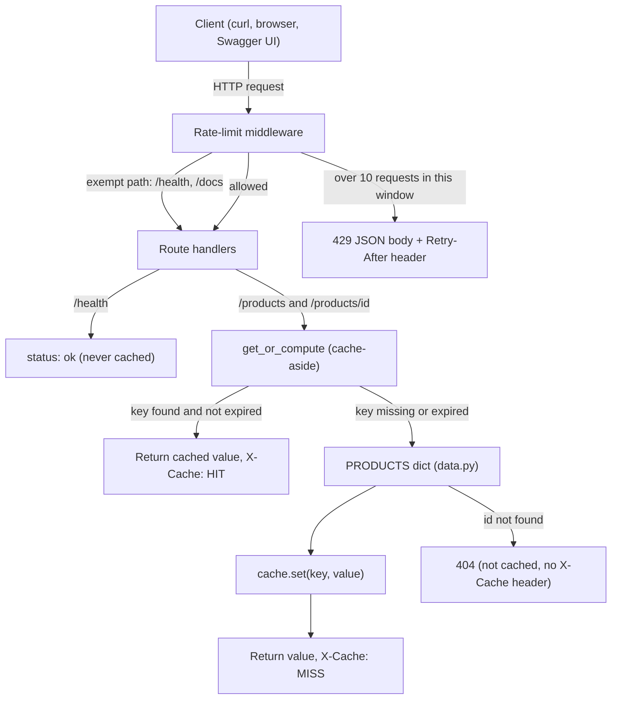

# Mini Product Catalog API

A small FastAPI service that serves a static product catalog, with two system-design features built from scratch and tested without waiting on real time:

- an **in-memory cache** with a 30-second TTL (`X-Cache: HIT` / `MISS` on every cached response)
- a **fixed-window rate limiter**: 10 requests per minute per client IP, returning `429 Too Many Requests` with a JSON body and a `Retry-After` header

---

## Features

| Feature | Details |
| --- | --- |
| Endpoints | `GET /products`, `GET /products/{product_id}`, `GET /health` |
| Validation | Pydantic `Product` model; invalid ids return `422`, missing ids return `404` |
| Caching | 30 s TTL, lazy expiration, keyed by path + query string, `X-Cache` header |
| Rate limiting | Fixed 60 s window, 10 requests per client IP, `429` + `Retry-After` |
| Exemptions | `/health`, `/docs`, `/openapi.json`, `/redoc` are not rate-limited |
| Tests | 31 pytest tests using an injectable fake clock (no `sleep`) |

---

## Architecture



The order matters: the rate limiter runs **before** any route, so a blocked request never touches the cache or the data. Cache HITs still count toward the rate limit, because every request costs the server something.

---

## Project structure

```
product-catalog-api/
├── app/
│   ├── __init__.py        # marks app/ as a package
│   ├── models.py          # Product Pydantic model (response schema)
│   ├── data.py            # 7 static products, dict keyed by id, duplicate-id guard
│   ├── cache.py           # TTLCache class
│   ├── rate_limiter.py    # RateLimitResult + FixedWindowRateLimiter
│   └── main.py            # FastAPI app, routes, cache-aside helper, middleware
├── tests/
│   ├── conftest.py        # FakeClock, clock fixture, client fixture
│   ├── test_api.py        # 18 HTTP-level tests
│   ├── test_cache.py      # 7 TTLCache unit tests
│   └── test_rate_limiter.py  # 6 rate limiter unit tests
├── docs/                  # evidence: transcripts and screenshots
├── pytest.ini
├── requirements.txt
├── AI_USAGE.md
├── NOTES.md
└── README.md
```

---

## Setup

Requires Python 3.10+ (developed on Python 3.14) and git.

```bash
git clone https://github.com/hemesh283/Product-Catalog-API.git
cd Product-Catalog-API
python -m venv .venv
```

Activate the virtual environment:

| Shell | Command |
| --- | --- |
| Windows Command Prompt | `.venv\Scripts\activate.bat` |
| Windows PowerShell | `.\.venv\Scripts\Activate.ps1` |
| macOS / Linux | `source .venv/bin/activate` |

Install the pinned dependencies:

```bash
python -m pip install -r requirements.txt
```

| Package | Why it is here |
| --- | --- |
| `fastapi` | The web framework: routes, validation, `/docs` |
| `uvicorn[standard]` | The ASGI server; `[standard]` adds `--reload` support |
| `httpx` | The HTTP client underneath FastAPI's `TestClient` |
| `pytest` | Test runner |

---

## Run

```bash
uvicorn app.main:app --reload
```

- API: http://127.0.0.1:8000
- Interactive docs (Swagger UI): http://127.0.0.1:8000/docs

---

## API reference

### `GET /health`

Liveness check for load balancers and monitors. Never cached, never rate-limited.

```json
{"status": "ok"}
```

### `GET /products`

Returns all 7 products. Cached for 30 seconds.

### `GET /products/{product_id}`

Returns one product. Cached for 30 seconds per id.

```json
{
  "id": 3,
  "name": "27-inch Monitor",
  "description": "1440p IPS monitor with 165Hz refresh rate.",
  "price_paise": 1599900,
  "image_url": "https://example.com/images/monitor.jpg"
}
```

Prices are stored as integer **paise** (₹15,999.00 = `1599900`) because floating-point numbers cannot represent money exactly.

### Responses

| Status | When | Body |
| --- | --- | --- |
| `200` | Success | Product or list of products |
| `404` | Valid id, but no such product | `{"detail": "Product 999 not found"}` |
| `422` | Id is not an integer (e.g. `/products/abc`) | FastAPI validation error with `loc`, `msg`, `input` |
| `429` | More than 10 requests in the current window | See below |

```json
{
  "detail": "Rate limit exceeded. Try again later.",
  "limit": 10,
  "window_seconds": 60,
  "retry_after": 55
}
```

The `429` response also carries a `Retry-After: 55` header (seconds until the next window).

---

## How caching works

### Why cache

A cache keeps a copy of a result so the next identical request skips the expensive work. In this project the "work" is a dictionary lookup, so the cache does not make anything faster; it demonstrates the pattern. In a real system the same code would sit in front of a database query taking 20-50 ms and adding load to a shared database, replacing it with a memory read taking microseconds.

### Why a TTL

A cache that never expires serves stale data forever. A **time to live** caps staleness: data is at most 30 seconds old. It is a deliberate trade-off: a longer TTL means less backend load but staler data; a shorter TTL means fresher data but more load.

### Design

- **Storage:** a plain Python dict mapping `key -> (value, expires_at)`. Storing the deadline (rather than the creation time) makes the expiry check one comparison and allows per-key TTLs later.
- **Clock:** `time.monotonic()`, not `time.time()`. The wall clock can jump (NTP sync, manual changes); a monotonic clock never goes backwards, so measured durations are always true.
- **Injectable clock:** `TTLCache(ttl_seconds, clock=time.monotonic)`. Tests pass a fake clock and move time forward instantly.
- **Lazy expiration:** an expired entry is deleted when someone reads it. No background thread is needed.
- **Boundary:** an entry is expired only when `now > expires_at`, so a request at exactly 30 seconds is still a HIT and one at 31 seconds is a MISS.
- **Fail fast:** a TTL of zero or less raises `ValueError` at startup.

### Wiring: cache-aside

Both product routes call one helper, `get_or_compute`:

1. Build the key from the request (**path + query string**, without the host, so `localhost` and `127.0.0.1` share one entry).
2. If the cache has a live entry, return it with `X-Cache: HIT`.
3. Otherwise run the real work, store the result, and return it with `X-Cache: MISS`.

The order on a MISS is **compute, store, set header**. If the lookup raises the 404, the function exits before storing or setting the header, so 404s are never cached and never carry `X-Cache`. Not caching 404s means a newly added product becomes visible immediately.

### Example

```
t = 0 s    GET /products/3   ->  X-Cache: MISS   (stored, expires at t = 30)
t = 10 s   GET /products/3   ->  X-Cache: HIT
t = 30 s   GET /products/3   ->  X-Cache: HIT    (boundary: not yet expired)
t = 31 s   GET /products/3   ->  X-Cache: MISS   (expired, deleted, recomputed)
```

### Where the cache lives

The cache is a dict in the RAM of the Uvicorn process. That means it is lost on restart (including `--reload`), and it is private to one process: with several workers or servers, each has its own cache. See [Known limitations](#known-limitations).

---

## How rate limiting works

### Why rate limit

Without a limit, one client can send unlimited requests. Rate limiting protects against abuse (scrapers, denial-of-service attempts) and brute-force attacks, keeps the service fair between users, and controls cost.

### The fixed-window algorithm

Time is cut into fixed 60-second windows. Each client gets a counter per window. Requests 1-10 in a window pass; request 11 onward gets `429` until the next window starts and the counter resets.

```
window 0: [0 s ......... 60 s)     window 1: [60 s ......... 120 s)
client A: 1 2 3 ... 10 ok, 11 -> 429   counter resets -> 1 2 3 ... ok
```

The current window is `int(now // 60)` (floor division), which is correct at every boundary: 59.9 is window 0, 60.0 is window 1.

### Design

- **Storage:** one entry per client, `client_ip -> (window_id, count)`. When a request arrives in a newer window, the entry is overwritten with `(new_window, 1)`, so old windows clean themselves up.
- **Result object:** `check()` returns a frozen dataclass `RateLimitResult(allowed, retry_after)`, so the middleware gets the decision and the wait time without repeating the window maths.
- **`Retry-After` is rounded up** with `math.ceil`. A client blocked at t = 125.7 in a window ending at 180 is told 55, not 54; a client that waited 54 seconds would arrive at 179.7, still inside the same window, and be blocked again.
- **Fail fast:** a limit or window of zero or less raises `ValueError`.

### Why middleware

The limiter runs as FastAPI HTTP middleware (the equivalent of a Spring `Filter`), so it applies to every route uniformly and rejects requests before any real work happens, even for unknown paths.

The middleware **returns** a `JSONResponse(status_code=429)` instead of raising `HTTPException`. FastAPI's exception handlers wrap the routes, but middleware runs outside them, so an exception raised there would surface as a `500`.

### What is exempt, and why

| Path | Why exempt |
| --- | --- |
| `/health` | Load balancers and Kubernetes probe it every few seconds. Throttling it would make a healthy server look dead and get it removed from rotation. |
| `/docs`, `/openapi.json`, `/redoc` | Developer convenience: opening the docs page fires several requests that would otherwise use up the quota. |

The limit is **per client IP across all routes**, not per endpoint: requests to `/products` and `/products/3` share the same 10.

---

## Testing

```bash
pytest -v
```

31 tests, under one second, no real waiting:

| File | Tests | Covers |
| --- | --- | --- |
| `tests/test_api.py` | 18 | Endpoints, 404, 422, MISS/HIT, expiry at 31 s, HIT at exactly 30 s, 404s not cached, 429 body and header, `Retry-After` rounding, window reset, shared limit across routes, `/health` exemption in both directions |
| `tests/test_cache.py` | 7 | `TTLCache` directly: miss, hit, lazy deletion, re-set refreshes expiry, `clear`, invalid TTL |
| `tests/test_rate_limiter.py` | 6 | Limiter directly: limit pattern, separate counters per client, window overwrite, invalid config |

### How time is tested without sleeping

`tests/conftest.py` defines a `FakeClock` whose time only moves when a test calls `clock.advance(seconds)`. The `client` fixture uses pytest's `monkeypatch` to replace the app's `cache` and `rate_limiter` with fresh instances built on that fake clock, then restores the originals after each test. Every test therefore starts with an empty cache, zero request counts, and time frozen at 0.

### Mutation testing

The boundary tests were checked by deliberately breaking the code:

| Mutation | Caught by |
| --- | --- |
| Cache expiry `>` changed to `>=` | `test_cache_still_hits_at_exactly_ttl` |
| `math.ceil` changed to `int` | `test_retry_after_is_rounded_up` |
| Limit check `<=` changed to `<` (limit becomes 9) | `test_eleventh_request_is_rate_limited` |

---

## Evidence

Manual test transcripts and screenshots (cache MISS -> HIT -> MISS, ten `200`s followed by `429`, `/health` while rate-limited, test run output) are in [`docs/evidence.md`](docs/evidence.md).

---

## Known limitations

These are deliberate simplifications for an assignment-sized project, and what a production system would do instead.

| Limitation | Why it happens | Production approach |
| --- | --- | --- |
| **Burst at window edges** | 10 requests at 0:59 and 10 at 1:01 all pass: up to 2x the limit in 2 seconds | Sliding window (count the last 60 s from now) or token bucket (steady refill, capped bursts) |
| **State is per process** | Cache and counters are dicts in one process's memory. With 4 workers, a client effectively gets 40 requests per minute, and each worker has its own cache (lower hit rate, possibly inconsistent data) | A shared store such as Redis, with atomic increments and built-in key expiry |
| **Lost on restart** | In-memory state disappears when the process stops | Redis or another external store |
| **Client IP behind a proxy** | `request.client.host` is whoever opened the connection; behind a load balancer every user shares the proxy's IP and one limit | Read `X-Forwarded-For`, trusting it only from known proxies, because clients can forge it |
| **Memory growth** | Expired cache entries that are never read again, and clients who never return, stay in memory | Periodic sweep, size cap with LRU eviction, or Redis TTLs |
| **Thread safety** | Plain `def` routes run in a thread pool, so the cache dict can be accessed from several threads at once | A lock around cache access, or an external store with atomic operations |
| **Window alignment** | `time.monotonic()` starts from an arbitrary origin, so windows do not align with clock minutes (and differ between machines) | Acceptable for a single process; a shared store gives one clock for all servers |
| **Cache key normalisation** | `?a=1&b=2` and `?b=2&a=1` are different keys | Sort query parameters when building the key |

---

## AI usage

This project was built with AI assistance as part of the assignment. What was asked, what was suggested, and what I changed or verified is documented step by step in [`AI_USAGE.md`](AI_USAGE.md). Design decisions and bugs encountered are recorded in [`NOTES.md`](NOTES.md).
