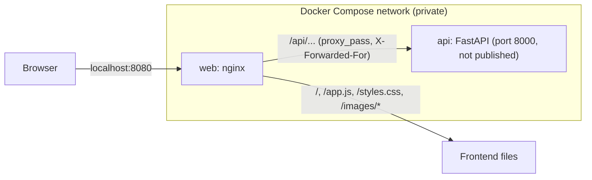
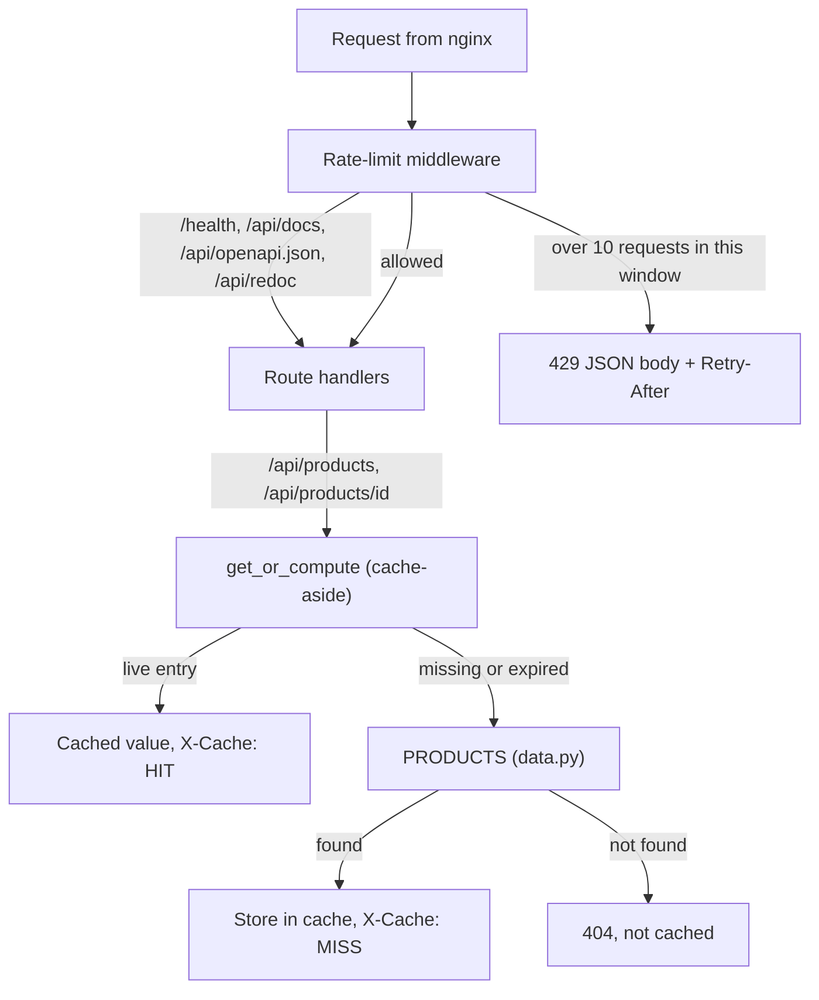

# Mini Product Catalog API

A small product catalog built to learn backend and DevOps fundamentals end to end: a FastAPI service with a hand-built **TTL cache** and **fixed-window rate limiter**, a plain HTML/JS **frontend**, an **nginx reverse proxy**, and **Docker Compose** to run it all.

- **In-memory cache** with a 30-second TTL (`X-Cache: HIT` / `MISS` on every cached response)
- **Fixed-window rate limiter**: 10 requests per minute per client IP, returning `429 Too Many Requests` with a JSON body and a `Retry-After` header
- **Frontend** that makes both features visible: cache badges, response times, a rate-limit countdown and a live "fire 11 requests" demo
- **nginx** in front: serves the frontend, proxies `/api/...` to FastAPI, and passes the real client IP to the rate limiter
- **32 pytest tests** using an injectable fake clock, so expiry and rate-limit windows are tested without waiting

The goal is not complexity. It is to implement each concept correctly, understand every line, and prove the behaviour with tests.

---

## Features

| Area | Details |
| --- | --- |
| API | `GET /api/products`, `GET /api/products/{product_id}`; `GET /health` for infrastructure only |
| Validation | Pydantic `Product` model; non-integer ids return `422`, missing ids return `404` |
| Caching | 30 s TTL, lazy expiration, keyed by path + query string, `X-Cache` header |
| Rate limiting | Fixed 60 s window, 10 requests per client IP, `429` + `Retry-After` |
| Frontend | Product grid, detail view (hash routing), cache badge with response time, rate-limit countdown, live demo button |
| Reverse proxy | nginx serves static files and forwards `/api/...`; the API port is never published |
| Containers | Multi-stage API image (test and runtime targets), nginx image, Compose with health-based startup order |
| Tests | 32 pytest tests, runnable locally or inside a Linux container |

---

## Architecture



Inside the API, every request passes through the rate limiter before any route runs:



**Why two services?** nginx is good at being the public entrance and serving files fast; FastAPI holds the application logic. The browser only ever talks to nginx, the API is unreachable from outside, and because the page and the API share one origin there are no CORS issues.

---

## Project structure

```
product-catalog-api/
├── app/
│   ├── __init__.py
│   ├── models.py            # Product Pydantic model
│   ├── data.py              # 7 static products, duplicate-id guard
│   ├── cache.py             # TTLCache
│   ├── rate_limiter.py      # RateLimitResult + FixedWindowRateLimiter
│   └── main.py              # app, /api router, cache-aside helper, middleware
├── frontend/
│   ├── index.html           # page skeleton
│   ├── styles.css
│   ├── app.js               # fetch, rendering, hash routing, badges, countdown, demo
│   └── images/              # 7 product images (WebP, ~160 KB total)
├── nginx/
│   ├── default.conf         # static files + /api reverse proxy
│   └── Dockerfile           # nginx image with config and frontend baked in
├── tests/
│   ├── conftest.py          # FakeClock, clock and client fixtures
│   ├── test_api.py          # 19 HTTP-level tests
│   ├── test_cache.py        # 7 TTLCache unit tests
│   └── test_rate_limiter.py # 6 rate limiter unit tests
├── Dockerfile               # API image: base, test, runtime stages
├── compose.yaml             # production stack: api + web
├── compose.override.yaml    # development extras: live frontend bind mounts
├── .dockerignore
├── pytest.ini
├── requirements.txt         # runtime dependencies
├── requirements-dev.txt     # runtime + test dependencies
├── AI_USAGE.md
├── NOTES.md
└── README.md
```

---

## Quick start (Docker Compose)

Requires Docker Desktop (or Docker Engine with the Compose plugin).

```bash
git clone https://github.com/hemesh283/Product-Catalog-API.git
cd Product-Catalog-API
docker compose up -d --build
```

Open **http://localhost:8080**. Swagger UI is at **http://localhost:8080/api/docs**.

```bash
docker compose ps        # both services should show (healthy)
docker compose logs api  # API request log
docker compose down      # stop and remove containers and the network
```

### Development vs production mode

| Command | Files used | Frontend served from |
| --- | --- | --- |
| `docker compose up -d` | `compose.yaml` + `compose.override.yaml` (merged automatically) | Your live `frontend/` folder via a read-only bind mount: edit, save, refresh |
| `docker compose -f compose.yaml up -d` | `compose.yaml` only | The files copied into the `web` image at build time |

The API has no bind mount in either mode, so after changing Python code run `docker compose up -d --build`. After editing `nginx/default.conf` in development mode, run `docker compose restart web` (nginx reads its config only at startup).

`docker compose config` prints the merged configuration Compose will actually use.

### Startup order

`web` declares `depends_on: api: condition: service_healthy`, so nginx starts only after the API's healthcheck passes. Without this, nginx fails at startup with `host not found in upstream "api"`, because it resolves `proxy_pass` hostnames once, when it starts.

---

## Running without Docker

Requires Python 3.10+ (developed on 3.14).

```bash
python -m venv .venv
```

| Shell | Activate |
| --- | --- |
| Windows Command Prompt | `.venv\Scripts\activate.bat` |
| Windows PowerShell | `.\.venv\Scripts\Activate.ps1` |
| macOS / Linux | `source .venv/bin/activate` |

```bash
python -m pip install -r requirements-dev.txt
uvicorn app.main:app --reload
```

The API runs at http://127.0.0.1:8000 with Swagger at http://127.0.0.1:8000/api/docs. The frontend needs nginx, so use Docker Compose to see it.

| Package | Why it is here |
| --- | --- |
| `fastapi` | Web framework: routes, validation, OpenAPI docs |
| `uvicorn[standard]` | ASGI server; `[standard]` adds `--reload` and faster parsers |
| `httpx` | HTTP client underneath FastAPI's `TestClient` (dev only) |
| `pytest` | Test runner (dev only) |

---

## API reference

All product routes live under `/api` (changed in 2.0.0; see [Versions](#versions)).

### `GET /api/products`

All 7 products. Cached for 30 seconds.

### `GET /api/products/{product_id}`

One product. Cached for 30 seconds per id.

```json
{
  "id": 3,
  "name": "27-inch Monitor",
  "description": "1440p IPS monitor with 165Hz refresh rate.",
  "price_paise": 1599900,
  "image_url": "/images/monitor.webp"
}
```

- Prices are integer **paise** (₹15,999.00 = `1599900`), because floating-point numbers cannot represent money exactly. The frontend formats them with `Intl.NumberFormat("en-IN")`.
- `image_url` is a relative path served by nginx; the API never sends image bytes.

### `GET /health`

Liveness check, `{"status": "ok"}`. Used by Docker's healthcheck and Compose startup order. It stays at the root (not under `/api`), is exempt from rate limiting, and is **not exposed through nginx**.

### Responses

| Status | When | Body |
| --- | --- | --- |
| `200` | Success | Product or list of products |
| `404` | Valid id, but no such product | `{"detail": "Product 999 not found"}` |
| `422` | Id is not an integer (`/api/products/abc`) | FastAPI validation error with `loc`, `msg`, `input` |
| `429` | More than 10 requests in the current window | See below |

```json
{
  "detail": "Rate limit exceeded. Try again later.",
  "limit": 10,
  "window_seconds": 60,
  "retry_after": 55
}
```

The `429` also carries a `Retry-After: 55` header (seconds until the next window).

---

## How caching works

### Why cache, and why a TTL

A cache keeps a copy of a result so the next identical request skips the work. Here the "work" is a dictionary lookup, so the cache demonstrates the pattern rather than speeding anything up; in front of a database query taking 20-50 ms it would replace that with a memory read taking microseconds. A **time to live** caps staleness: data is at most 30 seconds old. Longer TTLs mean less load but staler data; shorter TTLs mean fresher data but more load.

### Design

- **Storage:** a dict mapping `key -> (value, expires_at)`. Storing the deadline makes the expiry check one comparison.
- **Clock:** `time.monotonic()`, which never jumps backwards, unlike the wall clock. It is injectable, so tests pass a fake clock.
- **Lazy expiration:** an expired entry is deleted when it is next read.
- **Boundary:** expired only when `now > expires_at`, so a request at exactly 30 s is still a HIT and one at 31 s is a MISS.
- **Fail fast:** a TTL of zero or less raises `ValueError` at startup.

### Wiring: cache-aside

Both product routes call `get_or_compute`:

1. Build the key from the request: **path + query string**, without the host (so `localhost` and `127.0.0.1` share one entry).
2. If there is a live entry, return it with `X-Cache: HIT`.
3. Otherwise run the real work, store the result, and return it with `X-Cache: MISS`.

The order on a MISS is **compute, store, set header**. If the lookup raises a 404, nothing is stored and no header is set, so 404s are never cached and a newly added product appears immediately.

```
t = 0 s    GET /api/products/3   ->  X-Cache: MISS   (expires at t = 30)
t = 10 s   GET /api/products/3   ->  X-Cache: HIT
t = 30 s   GET /api/products/3   ->  X-Cache: HIT    (boundary)
t = 31 s   GET /api/products/3   ->  X-Cache: MISS   (expired, recomputed)
```

### Three cache layers in this project

| Layer | Where it lives | What it caches |
| --- | --- | --- |
| Browser cache | The user's browser | Images, CSS and JS, using the `ETag` and `Last-Modified` headers nginx adds to static files |
| TTL cache | Memory of the API process | `/api/products` responses for 30 s, shared by all users |
| nginx | n/a | Nothing: it reads static files from disk on each request |

---

## How rate limiting works

### Why rate limit

Without a limit, one client can send unlimited requests. Rate limiting protects against abuse and brute force, keeps the service fair, and controls cost.

### The fixed-window algorithm

Time is cut into fixed 60-second windows, and each client gets a counter per window. Requests 1-10 pass; request 11 onward gets `429` until the next window starts. The current window is `int(now // 60)`.

```
window 0: [0 s ......... 60 s)         window 1: [60 s ......... 120 s)
client A: 1 2 3 ... 10 ok, 11 -> 429    counter resets -> 1 2 3 ... ok
```

### Design

- **Storage:** one entry per client, `client_ip -> (window_id, count)`, overwritten when a new window starts.
- **Result object:** `check()` returns `RateLimitResult(allowed, retry_after)`.
- **`Retry-After` is rounded up** (`math.ceil`), so a client that waits exactly that long lands in the next window.
- **Middleware:** runs before every route, so blocked requests never touch the cache or data. It **returns** a `JSONResponse(429)` rather than raising `HTTPException`, because middleware runs outside FastAPI's exception handlers.
- **Per IP, across all routes:** `/api/products` and `/api/products/3` share one quota. Cache HITs still count.

### Exemptions

| Path | Why |
| --- | --- |
| `/health` | Docker and load balancers poll it constantly; throttling it would make a healthy service look dead |
| `/api/docs`, `/api/openapi.json`, `/api/redoc` | Developer convenience |

Only requests that reach the API count. Pages, scripts and images are served by nginx and never touch the limiter.

---

## Reverse proxy and real client IPs

In `nginx/default.conf`:

```nginx
location /api/ {
    proxy_pass http://api:8000;
    proxy_set_header Host $host;
    proxy_set_header X-Forwarded-For $remote_addr;
    proxy_set_header X-Forwarded-Proto $scheme;
}
```

- `api` is the Compose service name; Docker's internal DNS resolves it.
- **No trailing slash** after `8000`, so `/api/products/3` is forwarded unchanged. With `http://api:8000/` nginx would strip the `/api/` prefix.
- **`X-Forwarded-For $remote_addr` overwrites** any value the client sent. nginx is the edge proxy, so appending (`$proxy_add_x_forwarded_for`) would let clients forge their IP and dodge the rate limit.
- Uvicorn runs with `--proxy-headers --forwarded-allow-ips "*"`, so `request.client.host` becomes the forwarded IP. Trusting every sender is safe **only** because the API port is not published: nginx is the only thing that can reach it.

Verified: the API logs the IP nginx saw (`172.18.0.1`, Docker's gateway when testing locally), not nginx's own container IP (`172.18.0.3`).

---

## Frontend

Plain HTML, CSS and JavaScript, no framework. nginx serves the files; `app.js` fetches data from the API and builds the page (client-side rendering).

| Feature | How it works |
| --- | --- |
| Product grid | `fetch("/api/products")`, one card per product; CSS grid adapts columns to screen width |
| Detail view | Hash routing: `/#/products/3`. The part after `#` never reaches the server; a `hashchange` listener redraws the view, and the Back button works |
| Cache badge | Reads the `X-Cache` response header (possible because the page and API share one origin) and shows HIT or MISS with the round-trip time |
| Rate-limit message | A `RateLimitError` carries `Retry-After`; the page counts down and reloads automatically |
| Demo button | Sends 11 requests one after another (`await` inside a loop) and shows each status as a coloured chip |

- API data is inserted with `textContent`, never `innerHTML`, so product text can never run as script (XSS prevention).
- Product images were AI-generated (ChatGPT), renamed to lowercase names without spaces (Linux file names are case-sensitive), and converted to 600 px WebP, reducing them from 15 MB to about 160 KB.
- The response time shown is measured in the browser from `fetch()` until the response headers arrive, so it differs slightly from DevTools' "Time" column, which also includes the body download.

---

## Testing

```bash
pytest -v
```

32 tests, under one second, no real waiting:

| File | Tests | Covers |
| --- | --- | --- |
| `tests/test_api.py` | 19 | Endpoints, 404, 422, old unprefixed path returns 404, MISS/HIT, expiry at 31 s, HIT at exactly 30 s, 404s not cached, 429 body and header, `Retry-After` rounding, window reset, shared limit across routes, `/health` exemption |
| `tests/test_cache.py` | 7 | `TTLCache` directly |
| `tests/test_rate_limiter.py` | 6 | Limiter directly, including separate counters per client |

`tests/conftest.py` defines a `FakeClock` that only moves when a test calls `clock.advance(seconds)`. The `client` fixture uses `monkeypatch` to swap in a fresh cache and rate limiter built on that clock for every test.

Run the same tests inside a Linux container:

```bash
docker build --target test -t catalog-api:test .
docker run --rm catalog-api:test
```

Proxy-header behaviour cannot be tested with `TestClient` (it calls the app without Uvicorn), so it was verified manually through nginx.

---

## Docker images

### API (`Dockerfile`)

| Stage | Contents | Purpose |
| --- | --- | --- |
| `base` | `python:3.14-slim` + runtime dependencies | Shared and cached by both targets |
| `test` | `base` + `httpx`, `pytest`, `tests/` | Runs the test suite |
| `runtime` | `base` + `app/` only, non-root user, healthcheck | The image that ships |

- Dependencies are installed before code is copied, so code changes reuse the cached dependency layer.
- Runs as `appuser`; the code is owned by root, so the app cannot modify itself.
- `--host 0.0.0.0`: inside a container, `127.0.0.1` is unreachable through port mapping.
- One Uvicorn worker, because the cache and counters live in process memory.

### Web (`nginx/Dockerfile`)

`nginx:1.30.6-alpine` with `default.conf` and the `frontend/` folder copied in. The image's own `nginx.conf` already provides worker processes, connections and MIME types; `default.conf` only adds the `server` block, which is included inside its `http` block.

### Published images

| Version | Images |
| --- | --- |
| 1.0.0 | `hemesh283/product-catalog-api:1.0.0` (API only, routes at the root) |
| 2.0.0 | `hemesh283/product-catalog-api:2.0.0`, `hemesh283/product-catalog-web:2.0.0` |

Compose names images `...:${TAG:-dev}`, so a release build is `TAG=2.0.0 docker compose build`.

---

## Versions

| Version | Changes |
| --- | --- |
| `v1.0-assignment` | Original assignment submission: API, cache, rate limiter, tests, docs |
| `1.0.0` | Containerized API, published to Docker Hub |
| `2.0.0` | **Breaking:** product routes moved to `/api/...`. Added frontend, nginx reverse proxy, Docker Compose, real-client-IP forwarding, local WebP images |

---

## Known limitations

| Limitation | Why it happens | Production approach |
| --- | --- | --- |
| Burst at window edges | 10 requests at 0:59 and 10 at 1:01 all pass: up to 2x the limit in 2 seconds | Sliding window or token bucket |
| State is per process | Cache and counters are dicts in one process; several workers or containers would each keep their own (looser limit, lower hit rate) | A shared store such as Redis |
| Lost on restart | In-memory state disappears when the container restarts | Redis or another external store |
| Local client IP | Behind Docker Desktop's port mapping, nginx itself sees the gateway IP, so all local users share one limit | On a real server nginx receives client connections directly; no code change needed |
| nginx caches DNS | nginx resolves `api` once at startup; if the API container gets a new IP, nginx returns 502 until restarted | The `resolver` directive with a variable in `proxy_pass` |
| Memory growth | Expired cache entries never read again, and clients who never return, stay in memory | Periodic sweep, LRU size cap, or Redis TTLs |
| Thread safety | Plain `def` routes run in a thread pool, so the cache dict can be touched from several threads | A lock, or an external store with atomic operations |
| Frontend refetches | Returning to the grid re-requests data the page already had, using rate-limit quota | A client-side cache in JavaScript |
| Cache key normalisation | `?a=1&b=2` and `?b=2&a=1` are different keys | Sort query parameters when building the key |
| Floating Python base tag | `python:3.14-slim` points to the newest 3.14 patch, so rebuilds can differ | Pin a full tag or an image digest (nginx is already pinned) |
| No HTTPS | `localhost` has no domain to certify | Terminate TLS at nginx with a certificate (for example Let's Encrypt) when deployed |

---

## AI usage

Built with AI assistance as a learning exercise. What was asked, what was suggested, and what I changed or verified is documented in [`AI_USAGE.md`](AI_USAGE.md). Design decisions and bugs are recorded in [`NOTES.md`](NOTES.md).